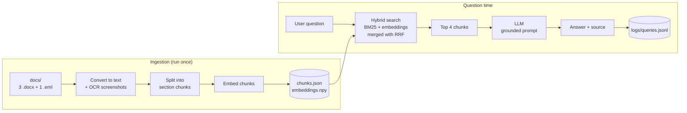

<div align="center">

# BCT Nexus

### Company Policy Assistant: RAG-Powered HR Knowledge Platform

A retrieval-augmented question answering system that reads company policy documents
and replies to employees in plain language, with a source for every answer.

<br>


**Team:** `<Nexus>` (solo) &nbsp;|&nbsp; **Author:** Anbi105

</div>

---

## 1. Architectural Overview

BCT Nexus is a compact RAG (Retrieval-Augmented Generation) system. It does not answer from the model's memory. For every question it first retrieves the most relevant sections of the policy documents, then instructs the LLM to answer using only that text and to name its source. When the documents do not contain the answer, the assistant says so instead of guessing.

The slow work (document parsing, OCR, embedding) runs once at ingestion time. At question time, retrieval takes milliseconds and the answer is streamed to the browser.

### High-Level System Design



---

## 2. Technology Stack

| Layer | Technology | Purpose |
|---|---|---|
| Language | Python 3.11 | Entire pipeline, server and evaluation |
| Document Parsing | python-docx, email module | Reads `.docx` manuals and the `.eml` email |
| OCR | Tesseract, pytesseract, Pillow | Extracts text from screenshots and flowcharts |
| Keyword Search | BM25 (custom implementation) | Exact-term matching such as "21st", "G5", "LOP" |
| Embeddings | fastembed, `BAAI/bge-small-en-v1.5` | Meaning-based matching for reworded questions |
| Vector Store | NumPy array | Simple and sufficient for 73 chunks |
| Rank Fusion | Reciprocal Rank Fusion | Merges keyword and semantic rankings |
| LLM | Groq, `openai/gpt-oss-120b` | Grounded answer generation at temperature 0 |
| Interface | Python `http.server`, single-page HTML | Streaming chat UI with source viewer |
| Evaluation | `eval.py`, `evals.json` | Automated scoring of retrieval and answers |

---

## 3. Core Modules

### Ingestion
- Converts every document in `docs/` to plain text and saves it in `data/text/`, including the email, which is parsed from `.eml` to text.
- Reads text embedded in screenshots and flowcharts using OCR, with results cached in `data/ocr_cache.json`.
- Splits documents **by section heading**, up to 180 words per chunk, with one line of overlap on long sections.
- Prefixes each chunk with `[Document | Section]` so retrieval and the LLM know its origin.

### Retrieval
- **BM25** ranks chunks by weighted keyword overlap.
- **Embeddings** rank chunks by cosine similarity to the question.
- **Reciprocal Rank Fusion** combines both lists, scoring each chunk as the sum of `1 / (60 + rank)`.
- The top **4** chunks are passed to the LLM.

### Generation
- The prompt restricts the model to the supplied excerpts.
- Missing answers return a fixed reply: *"I couldn't find this in the policy documents."*
- Numbers, dates and grades are quoted exactly, and every answer ends with its source.
- Temperature is 0 for repeatable output.

### Interface
- Streams answers word by word.
- **Sources used** panel shows the exact retrieved chunks and timings.

---

## 4. Knowledge Base

| Document | Format | Chunks |
|---|---|---|
| 5 Day Work Week, effective 15 July 2026 | `.eml` converted to text | 7 |
| Regularization User Manual | `.docx` | 24 |
| Timecard User Manual | `.docx` | 29 |
| Claims User Manual | `.docx` | 13 |
| **Total** | | **73** |

---

## 5. Evaluation

`evals.json` contains 14 questions whose answers were taken directly from the documents: 12 answerable questions and 2 that are deliberately absent from the knowledge base.

Each question is scored twice:
- **Retrieval hit:** did the retrieved chunks contain the needed facts?
- **Answer correct:** does the final answer contain the expected facts (or, for absent topics, say it couldn't find them)?

Scoring the two separately shows whether a failure is a search problem or a generation problem.

| Metric | Result |
|---|---|
| Answers correct | **14 / 14 (100%)** |
| Retrieval hits (answerable questions) | **12 / 12** |

<details>
<summary><b>View the 14 test questions</b></summary>

| # | Question | Expected |
|---|---|---|
| 1 | Hours of office clock-in required each day? | 9 hours |
| 2 | Payroll cut-off date every month? | 21st |
| 3 | Who is eligible for the five-day work week? | Grade G5 and above |
| 4 | Days not regularized with no leave applied? | Loss of Pay (LOP) |
| 5 | Who approves five-day work week exceptions? | Reporting Manager, Business Head, HRBP |
| 6 | Marking attendance from a client site? | ON-SITE |
| 7 | Days allowed to perform a regularization request? | 15 days |
| 8 | Minimum biometric attendance for regularization? | More than 7 hours |
| 9 | When to use Missed to Swipe? | Either in-time or out-time missed |
| 10 | Maximum normal timecard hours per day (India)? | 9 hours |
| 11 | Contact if a task is missing in the timecard dropdown? | RMG |
| 12 | What happens to a claim after manager approval? | Goes to Finance |
| 13 | How many casual leaves per year? | Not in documents |
| 14 | What is the maternity leave policy? | Not in documents |

</details>

---

## 6. Logging

Every question, from the UI or from the evaluation run, appends one JSON line to `logs/queries.jsonl`:

```json
{
  "timestamp": "2026-11-22T13:55:18",
  "tag": "app",
  "question": "What is the payroll cut-off date?",
  "retrieved": [
    { "id": "...", "doc_title": "...", "section": "...", "bm25": 12.36, "vector": 0.79, "rrf": 0.0328, "text": "..." }
  ],
  "answer": "...",
  "llm": "groq:openai/gpt-oss-120b",
  "retrieval_ms": 4.1,
  "first_token_s": 0.52,
  "total_s": 1.1
}
```

This records the question, the retrieved parts of the documents with their scores, the final answer, and timings. The `tag` field separates UI questions (`app`) from evaluation runs (`eval`).

---

## 7. Installation & Deployment

### Dependencies

| Requirement | Version |
|---|---|
| Python | 3.10 to 3.12 |
| Groq API key | Free at [console.groq.com/keys](https://console.groq.com/keys) |
| Tesseract OCR | Optional, only to re-run OCR (results are cached) |

### Startup Sequence

```bash
# 1. Clone the repository
git clone https://github.com/Anbi105/bct-policy-assistant.git
cd bct-policy-assistant

# 2. Create a virtual environment and install packages
python -m venv .venv
.venv\Scripts\Activate.ps1            # macOS / Linux: source .venv/bin/activate
python -m pip install -r requirements.txt

# 3. Add your API key
copy .env.example .env                # macOS / Linux: cp .env.example .env
# open .env and set GROQ_API_KEY=your_key_here

# 4. Build the knowledge base (once)
python ingest.py

# 5. Launch the assistant
python server.py

# 6. (Optional) Run the evaluation
python eval.py
```

Visit the application at **http://127.0.0.1:8000**.

### Configuration

| Variable | Default | Purpose |
|---|---|---|
| `LLM_PROVIDER` | `groq` | `groq`, `gemini` or `ollama` |
| `LLM_MODEL` | provider default | Override the model name |
| `TOP_K` | `4` | Chunks sent to the LLM |
| `USE_EMBEDDINGS` | `1` | `0` for keyword-only search |
| `USE_OCR` | `1` | `0` to skip screenshot OCR |
| `PORT` | `8000` | Web server port |

---

## 8. Project Structure

```
bct-policy-assistant/
├── docs/              Source documents (.docx, .eml)
├── data/              Converted text, chunks, OCR cache
├── logs/              queries.jsonl and eval_results.json
├── ui/index.html      Web interface
├── ingest.py          Documents to text to chunks to embeddings
├── ocr.py             Screenshot text extraction
├── convert_email.py   Standalone .eml to .txt conversion
├── rag.py             Retrieval, prompt, LLM call, logging
├── server.py          Web server
├── eval.py            Evaluation runner
├── evals.json         Test questions with expected answers
└── config.py          Settings loaded from .env
```

---

## 9. Design Decisions

- **Section-based chunking:** each chunk covers one topic, which makes retrieval more precise than splitting by fixed length.
- **Hybrid retrieval:** BM25 catches exact terms and embeddings catch rewording. Fusing the two outperforms either alone.
- **Top 4 chunks:** related facts can live in different documents (for example, the 15-day rule in a manual and the 21st payroll cut-off in the email), so four chunks keep both in view.
- **No vector database:** with 73 chunks, a NumPy array keeps the system simple to understand and explain.
- **Ingestion separated from querying:** OCR and embedding happen once, so answering stays fast.

---

---

<div align="center">

**Built by Anbi105**

*Grounded answers. Visible sources.*

</div>
