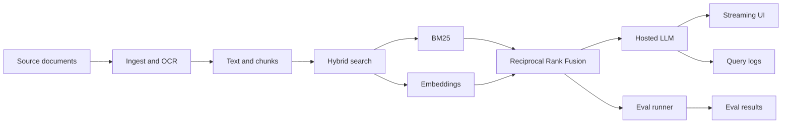

# <div align="center">BCT Nexus</div>

<p align="center"><strong>An HR policy assistant for BCT employees, powered by retrieval-augmented generation.</strong></p>

<p align="center">
  
  
  
  
</p>

BCT Nexus answers questions from the Claims, Regularization, and Timecard user manuals plus the 5 Day Work Week email. It retrieves relevant document excerpts, sends them to an LLM with a context-only prompt, and streams the response in a browser interface.

## Table of Contents

- [Features](#features)
- [Pipeline](#pipeline)
- [How It Works](#how-it-works)
- [Knowledge Base](#knowledge-base)
- [Quick Start](#quick-start)
- [Configuration](#configuration)
- [Evaluation](#evaluation)
- [Project Structure](#project-structure)
- [Logging](#logging)
- [Limitations](#limitations)
- [Future Improvements](#future-improvements)
- [Team](#team)

## Features

| Feature | Details |
|---|---|
| Document-grounded answers | Uses only retrieved context and returns a not-found response when context is insufficient |
| Hybrid retrieval | Combines BM25 keyword ranking with dense embeddings and Reciprocal Rank Fusion |
| Screenshot OCR | Reads embedded Word screenshots and flowcharts once during ingestion |
| Streaming UI | Sends newline-delimited streaming events to a responsive browser chat |
| Source inspection | Displays retrieved chunks and BM25, vector, and RRF scores |
| Retrieval fallback | Continues with BM25-only search if embeddings are disabled or unavailable |
| Evaluation suite | Separately measures retrieval and answer correctness |

## Pipeline



## How It Works

### Ingestion

`ingest.py` reads supported files from `docs/`, converts DOCX and EML files to text, and writes text versions to `data/text/`.

- DOCX: paragraphs and table rows are read in document order.
- EML: subject, sender, date, and the preferred plain or HTML body are converted to text.
- OCR: embedded Word images are processed with Tesseract once during ingestion and cached in `data/ocr_cache.json`.

OCR is not performed for live questions. It also is not applied to `.txt` or `.md` content.

### Chunking

The default maximum chunk size is **180 words**.

Chunks are split at rule-based major headings such as `A. Preface:` or numbered headings, and at subsection headings. Long sections are divided further. When a split occurs, the final line of the previous piece is retained as a one-line overlap. OCR text is placed in separate `Screenshots (OCR)` chunks. The system omits lines with fewer than three words and groups table metadata into `Document information` chunks.

Each chunk starts with its document title and section name.

### Retrieval

The retriever uses:

- **BM25:** custom implementation with `k1=1.5`, `b=0.75`, stop-word removal, light stemming, and six-character token truncation.
- **Embeddings:** `BAAI/bge-small-en-v1.5`, normalized to unit vectors.
- **Cosine similarity:** dot product over normalized query and document vectors.
- **Reciprocal Rank Fusion:** `sum(1 / (60 + rank))`, where ranks start at zero.
- **Top-k:** 4 chunks by default.

BM25 ranking and embedding ranking are fused when embeddings are enabled and available. Otherwise, retrieval uses BM25 only.

### Prompt and Streaming

The system prompt requires the model to use only supplied context, preserve exact numbers and dates, keep answers short, and identify the source. If the answer is absent, it must say:

> I couldn't find this in the policy documents.

The hosted provider receives an OpenAI-compatible `chat/completions` request with streaming enabled, temperature `0`, and a default limit of 350 answer tokens. `server.py` sends newline-delimited JSON events to the UI.

### Hosted Providers

The default configuration uses:

- Provider: `groq`
- Model: `llama-3.3-70b-versatile`
- Groq key environment variable: `GROQ_API_KEY`

Gemini and Ollama-compatible endpoints are also supported in code. The earlier local Ollama approach used `qwen2.5:3b`; the current README setup may use Groq, Gemini, or Ollama through configuration.

## Knowledge Base

| File | Content |
|---|---|
| `docs/Claims_User_Manual.docx` | Claims process and workflow |
| `docs/Regularization_User_Manual.docx` | Attendance regularization options and steps |
| `docs/Timecard_User_Manual.docx` | Timecard entry and approval process |
| `docs/Email_5_Day_Work_Week_Effective_15_July_2026.eml` | 5-Day Work Week guidelines |

Leave-plan and holiday-policy documents are not included. In particular, casual leave, maternity leave, and general leave/holiday policies are outside the current knowledge base.

## Quick Start

### Prerequisites

- Python 3.10, 3.11, or 3.12
- Tesseract OCR
- Internet access for the hosted LLM and the first embedding-model download
- A Groq API key for the default provider: <https://console.groq.com/keys>

On macOS, install Tesseract with `brew install tesseract`. On Debian/Ubuntu Linux, use `sudo apt install tesseract-ocr`.

### Windows PowerShell

```powershell
cd C:\path\to\BCT_Nexus

py -3.11 -m venv .venv
.\.venv\Scripts\Activate.ps1
python -m pip install -r requirements.txt

Copy-Item .env.example .env
python ingest.py
python server.py
```

Open `http://127.0.0.1:8000` if the browser is not opened automatically.

### macOS / Linux

```bash
cd /path/to/BCT_Nexus

python3 -m venv .venv
source .venv/bin/activate
python -m pip install -r requirements.txt

cp .env.example .env
python ingest.py
python server.py
```

### API Key Setup

Create a Groq API key, then add it to `.env`:

```text
LLM_PROVIDER=groq
GROQ_API_KEY=<your_groq_api_key>
```

Do not commit `.env` or paste API keys into this README.

## Configuration

All variables below are read or referenced by `config.py`.

| Variable | Default | Purpose |
|---|---|---|
| `LLM_PROVIDER` | `groq` | Provider: `groq`, `gemini`, or `ollama` |
| `GROQ_API_KEY` | empty | Groq API key |
| `GEMINI_API_KEY` | empty | Gemini API key |
| `LLM_API_KEY` | provider key fallback | Optional generic API-key override |
| `LLM_MODEL` | provider preset | Overrides the selected provider's model |
| `LLM_BASE_URL` | provider preset | Overrides the OpenAI-compatible API base URL |
| `MAX_ANSWER_TOKENS` | `350` | Maximum generated answer tokens |
| `TOP_K` | `4` | Number of chunks sent to the model |
| `USE_EMBEDDINGS` | `1` | Set to `0` to use BM25 only |
| `USE_OCR` | `1` | Set to `0` to skip OCR during ingest |
| `TESSERACT_CMD` | empty | Optional full path to the Tesseract executable |
| `EMBED_MODEL` | `BAAI/bge-small-en-v1.5` | FastEmbed embedding model |
| `PORT` | `8000` | Local web-server port |

Provider presets:

| Provider | Base URL | Model | Key variable |
|---|---|---|---|
| Groq | `https://api.groq.com/openai/v1` | `llama-3.3-70b-versatile` | `GROQ_API_KEY` |
| Gemini | `https://generativelanguage.googleapis.com/v1beta/openai` | `gemini-2.5-flash` | `GEMINI_API_KEY` |
| Ollama | `http://localhost:11434/v1` | `qwen2.5:3b` | none |

## Evaluation

`evals.json` contains 14 questions: 12 answerable questions and 2 negative cases. Retrieval is scored separately from answer correctness.

```powershell
python eval.py
python eval.py --retrieval-only
```

- Full evaluation checks both retrieval and LLM answers.
- `--retrieval-only` needs no API key.
- Results are written to `logs/eval_results.json`.
- `eval.py` retries HTTP 429 responses and pauses between full-evaluation questions.

**Evaluation score:** <add your eval score>

**Retrieval hit score:** <add your retrieval hit score>

## Project Structure

```text
BCT_Nexus/
├── config.py                 # Paths, provider presets, and environment settings
├── ingest.py                 # Converts documents and builds chunks and embeddings
├── ocr.py                    # Tesseract OCR and image-result cache
├── convert_email.py          # Standalone EML-to-text converter
├── rag.py                    # BM25, embeddings, RRF, prompts, streaming, and logging
├── server.py                 # Built-in Python web server and NDJSON endpoints
├── eval.py                   # Retrieval and answer evaluation runner
├── evals.json                # Evaluation questions and expected facts
├── requirements.txt          # Python dependencies
├── .env.example              # Environment-variable template
├── ui/index.html             # Browser chat interface
├── docs/                     # Source DOCX and EML knowledge-base files
├── data/
│   ├── text/                 # Converted text files
│   ├── chunks.json           # Chunk metadata and text
│   ├── embeddings.npy        # Dense chunk embeddings
│   └── ocr_cache.json        # Cached OCR results
└── logs/
    ├── queries.jsonl         # One runtime query record per line
    └── eval_results.json     # Per-question evaluation results
```

## Logging

Every question asked through the UI or evaluation runner is appended to `logs/queries.jsonl`. A record includes the timestamp, tag, question, retrieved chunk metadata and scores, answer, errors, provider/model, and timing fields.

The UI also keeps up to 40 recent conversations in browser `localStorage`; this history is not stored in the server database.

## Screenshot

Add the UI image at `docs/screenshots/ui.png`.

<p align="center">
  
</p>

## Limitations

- OCR can jumble flowchart word order and miss words.
- Heading detection is rule-based and may fail with differently formatted documents.
- OCR text is separated from the main document text, so it does not always preserve visual layout.
- The generated text and evaluation results depend on Tesseract and embedding availability.
- The knowledge base does not cover leave plans or holiday policies.
- The source manual's `C. Workflow:` section is empty.
- Streaming answers are context-grounded, but the LLM can still fail to combine or interpret retrieved excerpts correctly.

## Future Improvements

- Add higher-quality or layout-aware OCR processing.
- Add document structure-aware chunking instead of regex heading rules.
- Add a persistent vector database for larger knowledge bases.
- Add citation links with source passages and page locations.
- Expand the knowledge base and evaluation set.
- Add automated source and configuration validation.
- Add authenticated access if the UI is deployed beyond the local machine.

## Team

| Member | GitHub | Contribution |
|---|---|---|
| <Member 1 name> | <GitHub link> | <what they built> |
| <Member 2 name> | <GitHub link> | <what they built> |
